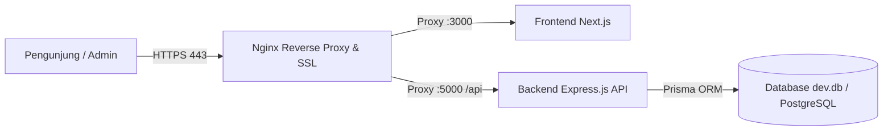

# 🏡 Pondok Rahmat — Sistem Landing Page & Property Management (Kostara)

Sistem informasi dan manajemen terpadu untuk **Pondok Rahmat (Kost Khusus Putri Samata, Gowa)**, mencakup:
* **Landing Page Publik:** Pemasaran kamar, galeri foto otentik, fasilitas, lokasi, dan formulir booking via WhatsApp.
* **Portal Penghuni (Tenant Portal):** Akses informasi kamar, riwayat tagihan, upload bukti bayar, dan laporan komplain.
* **Dashboard Admin (PMS):** Manajemen unit kamar, approval penyewa, penerbitan invoice & kwitansi sewa, penanganan komplain, dan pencadangan database.

---

## 📂 Struktur Repositori Monorepo

```text
kos-landing-page/
├── backend/            # Express.js REST API, Prisma ORM, JWT Auth, SQLite/PostgreSQL
│   ├── prisma/         # Skema database (schema.prisma) & seeder (seed.ts)
│   ├── src/            # Controllers, routes, middlewares, & validations
│   └── .env.example    # Template konfigurasi environment backend
├── frontend/           # Next.js 15 (App Router), Tailwind CSS, Lucide Icons
│   ├── public/         # Aset statis & foto kamar otentik (/images)
│   └── src/            # Halaman publik, dashboard admin (/admin), & portal penghuni (/portal)
├── docs/               # Panduan teknis arsitektur, desain, dan SOP deployment
├── run-dev.js          # Skrip runner otomatis backend & frontend lokal
├── package.json        # Unified runner script
└── README.md           # Dokumentasi utama proyek
```

---

## 💻 Panduan Menjalankan di Localhost (Development)

Ikuti langkah-langkah berikut untuk menjalankan sistem di komputer lokal Anda:

### 1. Prasyarat Sistem
* **Node.js:** Versi 18.x atau 20.x LTS ([Download Node.js](https://nodejs.org/))
* **Git:** Terpasang di komputer Anda

### 2. Instalasi Dependensi
Buka terminal di root direktori proyek, lalu pasang dependensi untuk backend dan frontend:
```bash
# 1. Pasang dependensi di root (opsional)
npm install

# 2. Pasang dependensi backend
cd backend
npm install

# 3. Pasang dependensi frontend
cd ../frontend
npm install

# Kembali ke root
cd ..
```

### 3. Konfigurasi Environment (`.env`)
Salin file template environment di folder `backend/`:
```bash
# Di folder backend:
cp backend/.env.example backend/.env
```
Isi file `backend/.env` untuk pengujian lokal:
```env
PORT=5000
DATABASE_URL="file:./dev.db"
JWT_SECRET="kunci-rahasia-jwt-bebas-untuk-pengujian-lokal-12345"
FRONTEND_URL="http://localhost:3000"
ADMIN_INITIAL_EMAIL="admin@kostara.id"
ADMIN_INITIAL_PASSWORD="adminpassword123"
```

### 4. Inisialisasi Database Lokal (SQLite)
Jalankan migrasi skema dan seeder data awal:
```bash
cd backend
npx prisma generate
npm run prisma:seed
cd ..
```
> **Catatan:** Script `seed.ts` menggunakan pola **UPSERT** aman. Script ini hanya akan membuat akun Super Admin dan data master "Kamar Standar" tanpa menghapus data kamar fisik atau riwayat transaksi lainnya.

### 5. Menjalankan Server Pengembangan
Dari root direktori proyek, jalankan:
```bash
npm run dev
```
Perintah ini akan menjalankan dua server sekaligus:
* **Backend Express API:** `http://localhost:5000` (Health check: `http://localhost:5000/api/health`)
* **Frontend Next.js:** `http://localhost:3000`

---

## 🔑 Panduan Akses Dashboard Admin (Localhost)

Setelah server berjalan, Anda dapat mengelola operasional kos melalui antarmuka Admin:

1. **Buka Halaman Login:**
   * Kunjungi: **[http://localhost:3000/login](http://localhost:3000/login)** (atau langsung ke `http://localhost:3000/admin`)
2. **Masukkan Kredensial Default Admin:**
   * **Email:** `admin@kostara.id`
   * **Kata Sandi:** `adminpassword123`
3. **Fitur-Fitur Utama di Dashboard Admin:**
   * **Manajemen Kamar (`/admin/kamar`):** Menambahkan nomor-nomor kamar fisik asli, menetapkan lantai, tipe kamar, dan status ketersediaan (*Tersedia, Terisi, Perbaikan*).
   * **Manajemen Penghuni (`/admin/penghuni`):** Menerima permohonan booking (*Inquiries*), mendaftarkan anak kos baru, dan mengatur masa sewa kontrak.
   * **Tagihan & Keuangan (`/admin/tagihan`):** Menerbitkan invoice sewa bulanan/tahunan, memverifikasi bukti bayar transfer, dan mencetak kwitansi resmi.
   * **Pusat Komplain (`/admin/komplain`):** Memantau dan merespons tiket keluhan fasilitas dari anak kos (*Pending, Dalam Proses, Selesai*).
   * **Pengaturan & Cadangan Data (`/admin/pengaturan`):**
     * Mengatur rekening bank transfer pembayaran.
     * Tab **Cadangan Data:** Mengunduh salinan database aktif (`kostara-backup-YYYY-MM-DD.db`) dalam 1 kali klik.

---

## 🌐 Panduan Deployment Produksi di VPS (Oracle Cloud / Ubuntu Linux)

Panduan ini ditujukan untuk men-deploy backend dan database pada Virtual Private Server (VPS Linux/Ubuntu 22.04 LTS), baik di **Oracle Cloud Infrastructure (OCI Always Free)**, DigitalOcean, IDCloudHost, dsb.



---

### Langkah 1: Persiapan Server VPS
1. Masuk ke terminal VPS Anda via SSH:
   ```bash
   ssh ubuntu@IP_PUBLIC_VPS_ANDA
   ```
2. Perbarui paket sistem:
   ```bash
   sudo apt update && sudo apt upgrade -y
   ```
3. Pasang **Node.js (v20 LTS)**, **Git**, dan **PM2**:
   ```bash
   curl -fsSL https://deb.nodesource.com/setup_20.x | sudo -E bash -
   sudo apt install -y nodejs git nginx certbot python3-certbot-nginx
   sudo npm install -g pm2
   ```

---

### Langkah 2: Clone Repositori Proyek
Clone repositori GitHub ke direktori server:
```bash
cd /var/www
sudo git clone https://github.com/USERNAME/REPO_NAME.git pondok-rahmat
sudo chown -R $USER:$USER /var/www/pondok-rahmat
cd /var/www/pondok-rahmat
```

---

### Langkah 3: Konfigurasi Environment Produksi (`backend/.env`)
Salin file template dan buat kredensial rahasia server:
```bash
cp backend/.env.example backend/.env
nano backend/.env
```
Sesuaikan nilainya untuk produksi:
```env
PORT=5000
DATABASE_URL="file:./dev.db"

# Kunci JWT rahasia (Gunakan string acak 32+ karakter)
JWT_SECRET="GantiDenganKarakterAcakYangSangatPanjangDanKuat!2026"

# Domain resmi Anda (Contoh: https://pondokrahmat.com)
FRONTEND_URL="https://domainanda.com"

# Kredensial Super Admin awal di VPS (Ganti dengan kata sandi rahasia pemilik kos!)
ADMIN_INITIAL_EMAIL="admin@pondokrahmat.com"
ADMIN_INITIAL_PASSWORD="PasswordSangatKuatDanRahasia!@#2026"

GOOGLE_CLIENT_ID="your-production-google-client-id"
```
> 🔒 **Keamanan:** File `backend/.env` ini dilindungi oleh `.gitignore` sehingga tidak akan pernah ter-push ke GitHub dan tidak akan hilang saat Anda `git pull` update kode di masa depan.

---

### Langkah 4: Build dan Inisialisasi Database Produksi
Jalankan instalasi dependensi, migrasi Prisma, seeder awal, dan kompilasi TypeScript:
```bash
# 1. Install & Build Backend
cd /var/www/pondok-rahmat/backend
npm install
npx prisma generate
npm run prisma:seed    # Membuat admin produksi & master tipe kamar
npm run build          # Kompilasi TypeScript ke folder dist/

# 2. Install & Build Frontend
cd /var/www/pondok-rahmat/frontend
npm install
npm run build          # Kompilasi Next.js untuk produksi
```

---

### Langkah 5: Jalankan Aplikasi 24/7 dengan PM2
Gunakan PM2 Process Manager agar server otomatis hidup kembali jika VPS me-restart:

```bash
# 1. Jalankan Backend Express API
cd /var/www/pondok-rahmat/backend
pm2 start dist/server.js --name "kostara-backend"

# 2. Jalankan Frontend Next.js
cd /var/www/pondok-rahmat/frontend
pm2 start npm --name "kostara-frontend" -- start

# 3. Simpan konfigurasi PM2 agar otomatis jalan saat boot
pm2 save
pm2 startup
```
* Cek status proses: `pm2 status`
* Cek log error backend: `pm2 logs kostara-backend`

---

### Langkah 6: Konfigurasi Nginx Reverse Proxy & SSL (HTTPS Gratis)
1. Buat file konfigurasi Nginx untuk domain Anda:
   ```bash
   sudo nano /etc/nginx/sites-available/pondokrahmat
   ```
2. Tempel konfigurasi berikut (ganti `domainanda.com` dengan domain Anda):
   ```nginx
   server {
       server_name domainanda.com www.domainanda.com;

       # Routing API Backend
       location /api/ {
           proxy_pass http://127.0.0.1:5000/api/;
           proxy_http_version 1.1;
           proxy_set_header Upgrade $http_upgrade;
           proxy_set_header Connection 'upgrade';
           proxy_set_header Host $host;
           proxy_set_header X-Real-IP $remote_addr;
           proxy_set_header X-Forwarded-For $proxy_add_x_forwarded_for;
           proxy_set_header X-Forwarded-Proto $scheme;
           client_max_body_size 15M;
       }

       # Routing Frontend Next.js
       location / {
           proxy_pass http://127.0.0.1:3000;
           proxy_http_version 1.1;
           proxy_set_header Upgrade $http_upgrade;
           proxy_set_header Connection 'upgrade';
           proxy_set_header Host $host;
           proxy_set_header X-Real-IP $remote_addr;
           proxy_set_header X-Forwarded-For $proxy_add_x_forwarded_for;
           proxy_set_header X-Forwarded-Proto $scheme;
       }
   }
   ```
3. Aktifkan konfigurasi dan restart Nginx:
   ```bash
   sudo ln -s /etc/nginx/sites-available/pondokrahmat /etc/nginx/sites-enabled/
   sudo nginx -t
   sudo systemctl restart nginx
   ```
4. Pasang Sertifikat SSL (HTTPS) Gratis via Certbot:
   ```bash
   sudo certbot --nginx -d domainanda.com -d www.domainanda.com
   ```

---

### Langkah 7: Mengakses Halaman Admin di Produksi
1. Buka browser: **`https://domainanda.com/login`**
2. Masuk menggunakan akun admin yang Anda tentukan di file `.env` VPS pada Langkah 3:
   * **Email:** `admin@pondokrahmat.com`
   * **Kata Sandi:** `PasswordSangatKuatDanRahasia!@#2026`
3. Setelah berhasil masuk ke Dashboard Admin, buka menu **Pengaturan > Akun** dan perbarui profil atau kata sandi Anda.

---

### Langkah 8: Prosedur Pembaruan Kode di VPS (Deployment Update)
Jika Anda telah memperbarui kode di laptop dan mengunggahnya ke GitHub (`git push`), ikuti langkah cepat berikut di VPS:

```bash
cd /var/www/pondok-rahmat

# 1. Tarik pembaruan dari GitHub
git pull origin main

# 2. Re-build Backend & Frontend
cd backend && npm install && npm run build
cd ../frontend && npm install && npm run build

# 3. Restart Service PM2 tanpa downtime
pm2 restart all
```
> Database (`dev.db`), file upload bukti bayar, dan file konfigurasi `.env` di VPS **dijamin 100% aman dan tidak akan hilang/tertimpa** saat melakukan perintah di atas.

---

## 📚 Indeks Dokumentasi Teknis

Dokumentasi rancangan sistem dan arsitektur lebih mendalam dapat dibaca pada folder [`docs/`](docs/):

* [**Panduan Identitas & Ketentuan Kos**](docs/PROJECT_GUIDELINES_KOS.md) — Ketentuan fasilitas otentik & aturan sewa putri Samata.
* [**Panduan Property Management System (PMS)**](docs/PROJECT_GUIDELINES_PMS.md) — Logika bisnis penagihan, kontrak, dan alur komplain.
* [**Panduan Desain Frontend**](docs/DESIGN_RULES_FRONTEND.md) — Pedoman antarmuka, warna `#1F3D35`, dan tipografi.
* [**Rencana Arsitektur Backend API**](docs/BACKEND_PLAN.md) — Struktur endpoint RESTful Express dan skema relasi Prisma.
* [**Rencana Deployment OCI Produksi**](docs/PRODUCTION_DEPLOYMENT_PLAN.md) — Konfigurasi Docker, firewall OCI, dan snapshot boot volume.

---

## 🛡️ Hak Cipta
Hak Cipta © 2026 **Pondok Rahmat Samata, Gowa**. Dikembangkan untuk efisiensi operasional kos yang transparan, modern, dan aman.
